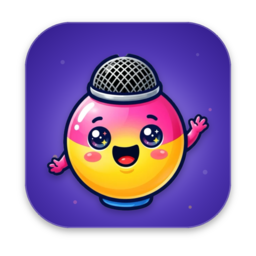
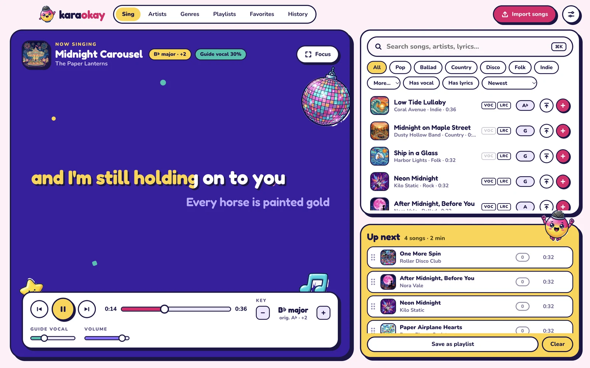
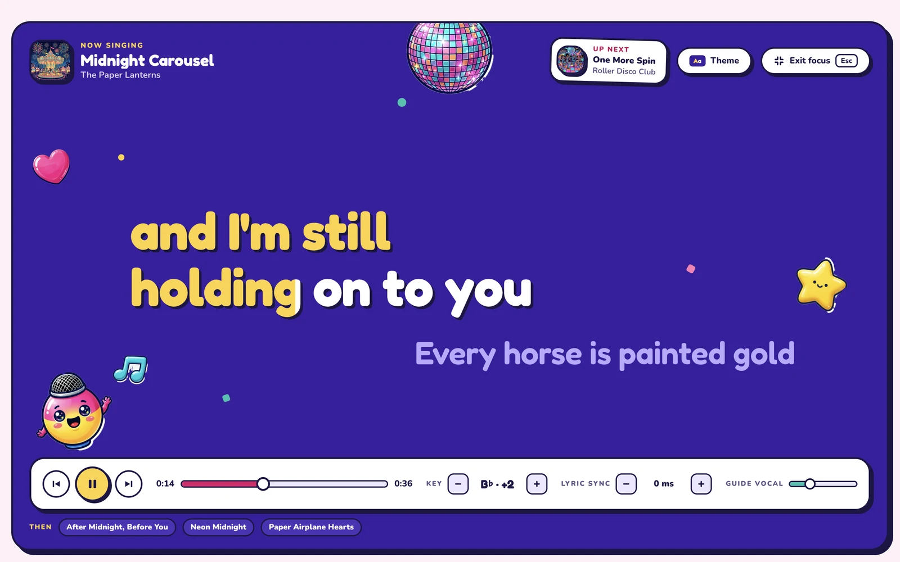
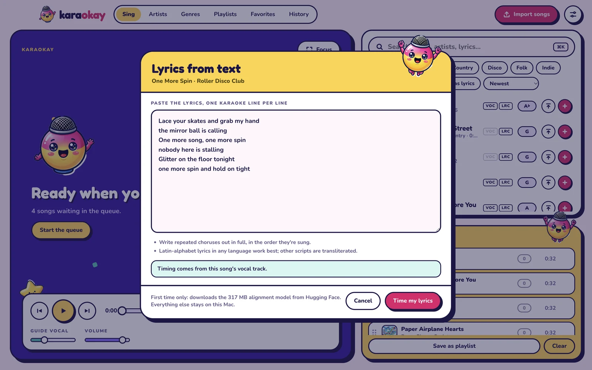
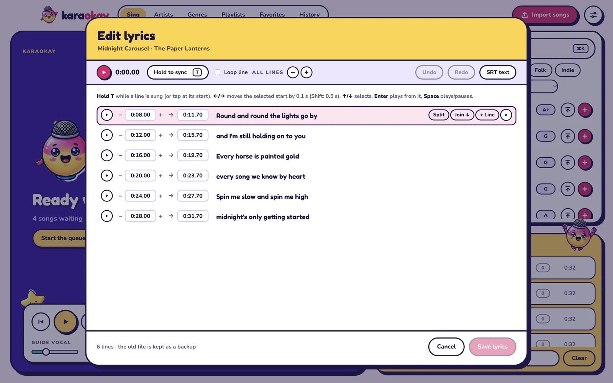

<p align="center">
  
</p>

<h1 align="center">Karaokay</h1>

<p align="center"><em>An okay karaoke software.</em></p>

<p align="center">
  A karaoke box that lives on your own computer: a big queue, big lyrics, any key you like,<br>
  and a microphone mascot who is way too excited about all of it.
</p>

<p align="center">
  
</p>

---

## What is this?

Karaokay is karaoke you host yourself. There's no subscription, no streaming catalogue, and you don't need the internet to sing. You bring the songs and Karaokay runs the party.

Bringing the songs used to be the hard part. A karaoke track needs an instrumental, a vocal track and lyrics timed to the music, and you could rarely get all three. AI has changed that, and an ordinary MP3 is now enough:

1. **Split it.** Run the song through [Ultimate Vocal Remover](https://github.com/Anjok07/ultimatevocalremovergui) to get an instrumental and a vocal track.
2. **Drop both files on Karaokay.** They're matched up by name.
3. **Paste the lyrics.** Karaokay listens to the vocal track and times every line for you. A small editor lets you fix any line that's slightly off.

After that, Karaokay works like the karaoke machine in a KTV room: queue songs, sing along to big lyrics, change the key to suit your voice, turn the guide vocal up or down, and save the night's songs as a playlist for next time.

## Features

**Singing**
- Big, bold lyrics with a highlight that sweeps through each line, plus a full-screen **Focus mode** for the TV
- **Key change** of ±6 semitones, without changing the speed. The song's original key is detected automatically.
- A **guide vocal** slider: mix in the original singer for help, or turn it off and sing it all yourself
- Lyric sync you can nudge while singing (`,` / `.`) and a short "up next" break between songs
- Optional muted **background videos** and five colour themes for Focus mode

**Hosting**
- A drag-to-reorder **queue**, with "play next" for the friend who's been waiting all night
- Search by title, artist **or a line from the lyrics**, and filter by genre, by songs with a vocal track, or by songs with lyrics
- Playlists, favourites and a history of what's been sung
- Keyboard shortcuts for everything (see [below](#keys))

**Your library**
- Drop in loose files or whole folders. Instrumentals, vocals, lyrics (SRT, LRC or plain text) and cover art are matched up for you.
- **Lyrics from text**: paste plain lyrics and get them timed against the vocal track
- A **lyric editor** for fine-tuning: hold <kbd>T</kbd> while a line is sung to set its timing, then split, join and nudge lines
- Share songs as a single **`.karaokay` file**: one song or a whole playlist, ready to import on another machine ([format spec](docs/KARAOKAY_FORMAT.md))
- Your songs stay as plain folders on your disk (`~/Music/Karaokay` by default), so nothing is locked in a database

## Screenshots

<table>
  <tr>
    <td width="50%"><br><sub><b>Focus mode.</b> Put it on the TV and hand someone the mic.</sub></td>
    <td width="50%"><br><sub><b>Lyrics from text.</b> Paste the words; Karaokay finds the timing.</sub></td>
  </tr>
  <tr>
    <td width="50%"><br><sub><b>Lyric editor.</b> Fix any line that's a beat early or late.</sub></td>
    <td width="50%"><br><sub><b>Sing view.</b> Search, queue and change key without leaving the stage.</sub></td>
  </tr>
</table>

<sub>All songs, artists, lyrics and cover art in the screenshots are made up for demo purposes.</sub>

## Get started

Karaokay runs on **macOS** (Apple silicon). There's no prebuilt download yet, so you build it yourself, which takes a couple of minutes. Clone this repository, then:

```sh
npm install
npm run dist          # makes dist/Karaokay-0.1.0-arm64.dmg
```

Open the `.dmg` and drag Karaokay to Applications. The build is unsigned, so the first time you open it, right-click the app › **Open**.

Then:

1. **Add songs.** Drop files or folders on the window, or press <kbd>⌘</kbd><kbd>I</kbd>.
   - Audio: MP3, WAV or FLAC. An instrumental is required; a vocal track is optional but recommended (it enables the guide vocal and automatic lyric timing).
   - Lyrics: `.srt` or `.lrc`, paired by file name (`Song (Instrumental).flac`, `Song (Vocals).flac`, `Song.srt`), or paste plain text in the import dialog.
2. **Sing.** Search on the right, hit the pink **+** to queue a song, and the first one starts straight away.
3. **Share.** Right-click a song › **Export as .karaokay…**, or press **Export…** on a playlist. Double-click a `.karaokay` file to import it.

Automatic lyric timing downloads a 317 MB alignment model from Hugging Face the first time you use it. Everything else, including your songs, stays on your Mac.

### Keys

| Key | Action |
|---|---|
| <kbd>Space</kbd> | Play / pause |
| <kbd>N</kbd> or <kbd>⌘</kbd><kbd>→</kbd> | Skip to next song |
| <kbd>R</kbd> or <kbd>⌘</kbd><kbd>←</kbd> | Restart song |
| <kbd>←</kbd> / <kbd>→</kbd> | Seek 5 s |
| <kbd>[</kbd> / <kbd>]</kbd> / <kbd>\\</kbd> | Key down / up / reset |
| <kbd>V</kbd> | Guide vocal on / off |
| <kbd>,</kbd> / <kbd>.</kbd> | Lyrics 50 ms earlier / later |
| <kbd>L</kbd> | Focus mode (big lyrics) |
| <kbd>F</kbd> | Fullscreen |
| <kbd>⌘</kbd><kbd>K</kbd> or <kbd>/</kbd> | Search |
| <kbd>Enter</kbd> / <kbd>⇧</kbd><kbd>Enter</kbd> / <kbd>⌘</kbd><kbd>Enter</kbd> | In search: add to queue / play next / play now |

Right-click any song for playlists, favourites, song details (fix the detected key there), lyric tools, background video and export.

## Develop

```sh
npm install          # also rebuilds better-sqlite3 for Electron
npm run dev          # hot-reloading app
npm test             # unit tests
npm run typecheck
npm run build        # bundle to out/
npm run dist         # package dist/*.dmg
```

Keep development data away from your real library:

```sh
node tools/make-fixtures.mjs tools/out/fixtures     # synthetic test songs (no copyrighted material)
KARAOKAY_HOME=tools/out/home npm run dev            # database + library under tools/out/home
```

`KARAOKAY_SNAPSHOT=out.png KARAOKAY_SNAPSHOT_SCRIPT='…'` runs a script in the renderer, saves a screenshot and quits. `window.__karaokaySelfTest('<dir>')` imports a folder, detects keys, runs searches and measures audio sync (see `src/renderer/dev/selftest.ts`).

Artwork: the app icon is built with `tools/art/make-icon.sh` (ImageMagick). Mockup art is generated with `tools/art/gen.sh` (needs `nanobanana`, `remove-bg`, ImageMagick and `GEMINI_API_KEY`).

Design notes and decisions: [`docs/DESIGN.md`](docs/DESIGN.md). Mockups: `docs/mockup/`.

### Layout

```
src/main        Electron main: SQLite (db/), library scan + import + .karaokay packages (library/),
                lyric alignment (align/), media protocol, IPC
src/preload     typed, channel-allow-listed bridge (window.api)
src/shared      types, IPC contract, SRT parser, key names, themes
src/renderer    React UI: audio/engine.ts (Signalsmith Stretch), analysis/ (essentia.js worker),
                lyrics/ (timeline, editor), stores/ (zustand), components/, views/
tests/unit      vitest
docs/           design notes, .karaokay format spec, screenshots
```

## Licence

Karaokay's own code is released under the [MIT License](LICENSE).

It builds on other people's work, and some of it comes with its own terms:

| Component | Used for | Licence |
|---|---|---|
| [essentia.js](https://github.com/MTG/essentia.js) | Key detection | **AGPL-3.0**. It is bundled into the built app, so **a build you distribute must follow AGPL-3.0** until essentia.js is replaced (see the fallback in [DESIGN §10](docs/DESIGN.md)). Personal use is fine. |
| [MMS forced aligner](https://huggingface.co/MahmoudAshraf/mms-300m-1130-forced-aligner) ([ONNX build](https://huggingface.co/onnx-community/mms-300m-1130-forced-aligner-ONNX)) | Automatic lyric timing | **CC BY-NC 4.0** (non-commercial). It is not included in this repository or the app; Karaokay downloads it the first time you time lyrics. |
| [Signalsmith Stretch](https://signalsmith-audio.co.uk/code/stretch/) | Key change | MIT |
| Fredoka and Nunito fonts | Interface | SIL Open Font License 1.1 |
| Other npm dependencies | | MIT, ISC or 0BSD |

Karaokay plays the files you give it. Please only use music you have the right to use.
